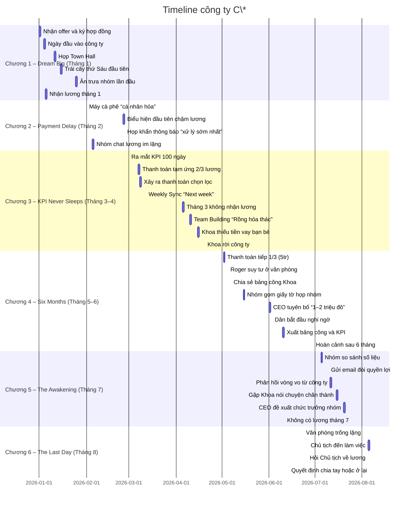

# Executive Summary  
Kịch bản **Công ty C\*** được xây dựng theo phong cách dark comedy/sim, xoay quanh hành trình một nhân viên mới bị công ty nợ lương kéo dài hơn 6 tháng. Báo cáo này tổng hợp timeline chuẩn (Tháng 1–8), phân tích từng chương (mục tiêu, cao trào, nút thắt, nhân vật, cảm xúc chủ đạo) và phát triển kịch bản chi tiết theo chap (tiêu đề, bối cảnh, cảnh chính, hội thoại mẫu, mục tiêu cảm xúc, chuyển biến nhân vật, hồ sơ liên quan). Ngoài ra, mỗi chap còn được mô tả ngắn gọn dưới dạng kịch bản video (shot list, thời lượng, không khí, âm thanh, visual cues) để sản xuất với Remotion/Claude. Checklist tham khảo pháp luật lao động (tiền lương, quyền lợi, xử lý nợ lương) và bài báo điều tra tạo tính xác thực.

# Timeline tổng thể (2026)  

# Phân tích từng chương

- **Chương 1 – Dream Big (Tháng 1):** Mục tiêu giai đoạn khởi đầu với niềm vui, hào hứng. Cao trào là khi nhân vật chính lần đầu nghe lời thị trưởng (“công ty không phải vì tiền”). Nút thắt: thắc mắc về ngày trả lương được lờ đi trong họp toàn công ty. Nhân vật chính cùng đồng nghiệp (Uyên, Dân, Khoa, Huni, Roger) xây dựng niềm tin. Cảm xúc chủ đạo: lạc quan, háo hức pha chút lo âu.

- **Chương 2 – Payment Delay (Tháng 2):** Mục tiêu tiếp tục hoàn thành công việc nhưng dấu hiệu khủng hoảng xuất hiện. Cao trào là báo cáo kế toán “đang xử lý”, lời hứa trả lương (cuối tháng 2) không được giữ. Nút thắt: lần đầu tiên tháng trôi qua mà không có “ting” lương. Nhân vật chính bắt đầu nghi hoặc nhưng vẫn tin tưởng. Cảm xúc: bất an, hoài nghi tăng dần.

- **Chương 3 – KPI Never Sleeps (Tháng 3–4):** Mục tiêu công ty đặt mục tiêu mới (KPI 100 ngày) thay vì lương. Cao trào: nhân vật hỏi trực tiếp về lương ở họp KPI, nhận câu trả lời “nhìn xa hơn”. Nút thắt: có người nhận tạm ứng tiền lương còn người không (bổ sung sự kiện *Selective Payment*). Sự kiện “Rồng vượt thác” huy động thêm lao động. Nhân vật chính phân vân giữa tiếp tục hy vọng hay bỏ đi (nhận đề nghị mới từ nơi khác). Cảm xúc: giằng xé, tức giận, thất vọng xen lẫn thất vọng ấm ức.

- **Chương 4 – Six Months Later (Tháng 5–6):** Mục tiêu đối mặt với hậu quả: nhiều người nghỉ việc, tìm cách gom chứng cứ. Cao trào: CEO hé lộ “1–2 triệu đô” (bẫy lùi thêm kỳ vọng). Nút thắt: đồng nghiệp Khoa bỏ công ty, gửi bảng công làm bằng chứng. Nhân vật nhóm họp bàn so số liệu (ý thức tập thể). Nhân vật chính lưu lại sổ sách, nghĩ đến buộc công ty trả lương. Cảm xúc: quyết tâm, giận dữ, hy vọng lẫn thất vọng.

- **Chương 5 – The Awakening (Tháng 7):** Mục tiêu đưa ra quyết định: đòi lại quyền lợi hay chấp nhận. Cao trào: nhóm nhân viên gửi email đòi lương chính thức, công ty vẫn vòng vo. Nút thắt: CEO mời nhân vật giữ vị trí (một lời đề nghị “lợi ích” đổi lấy lòng trung thành). Nhân vật chính phải quyết định giữ chức hay theo đuổi quyền lợi. Cảm xúc: gay gắt, bẽ bàng, giận dữ và ngỡ ngàng.

- **Chương 6 – The Last Day (Tháng 8):** Mục tiêu kết thúc: quyết định bỏ đi hay hy vọng. Cao trào: Chủ tịch trực tiếp xuống phòng trò chuyện (“đầu tư vào chính mình”). Nút thắt: câu hỏi “khi nào trả lương?” bị xoay đi. Nhân vật chính lựa chọn: rời công ty, ở lại thêm, hay theo đuổi quyền lợi. Cảm xúc: quyết liệt, hồi hộp, nhẹ nhõm hay ngao ngán tùy chọn.

# Đề xuất chi tiết chap (mẫu)

**Ví dụ Chương 3 – KPI Never Sleeps** (tổng 10 sub-chap):

1. **Tiêu đề:** Công bố chiến dịch 100 ngày. **Bối cảnh:** Họp toàn công ty, phòng họp lớn.  
   - *Cảnh chính:* Phó GĐ Jeon tuyên bố chiến dịch KPI, không nói về lương.  
   - *Đoạn hội thoại:*  
     - **Phó GĐ Jeon:** “Tình hình kinh doanh có thách thức, nhưng 100 ngày tới là cơ hội. Từ giờ, mỗi người có KPI riêng!”  
     - **Bạn:** “Dạ em ghi rồi ạ.” (im lặng)  
     - **Uyên (thầm nói với bạn):** “Xem nào, có nhắc gì về lương không.”  
   - *Mục tiêu cảm xúc:* Tăng căng thẳng khi công ty đẩy mạnh yêu cầu công việc.  
   - *Chuyển biến nhân vật:* Hồi hộp, bắt đầu nghi vấn rõ ràng hơn.  
   - *Giấy tờ/bằng chứng:* Bảng thông báo KPI (có thể chụp ảnh màn hình).  
   - **Video shot-list:** Quay cận gương mặt nhân vật chính nghển lên nhìn màn hình, cận cảnh đôi mắt lo lắng, sau đó pan cảnh toàn phòng họp (ánh đèn huỳnh quang, âm thanh bàn phím lạch cạch, nền nhạc tense). **Thời lượng:** ~45s.

2. **Tiêu đề:** Lương tháng 2 chia không đều. **Bối cảnh:** Văn phòng sáng hôm sau, mọi người check điện thoại.  
   - *Cảnh chính:* Một số người (kể cả Khoa) nhận được 10 triệu (2/3 lương), số khác (Uyên, bạn) không thấy gì.  
   - *Đoạn hội thoại:*  
     - **Bạn:** “Ủa, sao mình vẫn chưa có gì nhỉ?”  
     - **Khoa (nháy mắt):** “Nhận rồi, tớ có 2/3 lương kìa.”  
     - **Uyên (quay lại):** “Ghi sổ đi… chúng ta phải đối chiếu sau.”  
   - *Mục tiêu cảm xúc:* Bức xúc, chua xót vì minh chứng chênh lệch.  
   - *Chuyển biến:* Uyên khẳng định ngay việc cần ghi nhận, bạn bắt đầu lưu giữ chứng từ.  
   - *Giấy tờ:* Sao kê nhận lương và số còn nợ.  
   - **Video:** Quay cảnh mọi người ở chỗ làm, điện thoại rung, bản đồ GUI ứng dụng ngân hàng hiện, nhạc nền căng thẳng. **Thời lượng:** 60s.

3. **Tiêu đề:** Sync hàng tuần. **Bối cảnh:** Họp nhóm nhỏ với Roger.  
   - *Cảnh:* Cuộc họp tiến độ, nhân vật cuối giờ hỏi về lương.  
   - *Hội thoại:*  
     - **Roger:** “Anh đã hỏi rồi, *next week*, hy vọng.”  
     - **Bạn:** “Anh Roger ơi, *hopefully* nghĩa là…”  
     - **Roger:** “Là tin đi em ạ. Chúng ta cứ làm tốt phần mình.”  
     - **Huni:** “Từ giờ em cứ báo cáo đầy đủ, anh ghi chú lại rồi.”  
   - *Cảm xúc:* Mặt khác, tin cậy xen hoài nghi.  
   - *Chuyển biến:* Tin vào lời hứa của Roger, nhưng bạn ghi nhớ chặt chẽ.  
   - *Hồ sơ:* Ghi chú cuộc họp (bản word/ghi âm chat).  
   - **Video:** Cảnh quay xoay 360° phòng họp, Roger nói nhìn vào camera, cuts between gương mặt ngỏ lời của nhân vật. Nhạc nền nhẹ nhàng. **Thời lượng:** 30s.

(*Tương tự xây dựng 7 chap còn lại của Chương 3...*)

# Bảng nhân vật chính

| Nhân vật          | Đầu Game (T1)                   | Giữa Game (T2–T5)                   | Cuối Game (T6)                    |
|------------------|---------------------------------|--------------------------------------|-----------------------------------|
| **[Tên người chơi]** | Mới, háo hức, tin tưởng        | Hoài nghi, kiên trì thu thập chứng cứ | Quyết đoán: theo đuổi quyền lợi hoặc rời đi |
| **Roger (Trưởng phòng)** | Tin cậy lãnh đạo, nhiệt huyết | Bắt đầu nghi ngại, muốn bảo vệ đồng nghiệp | Cuối cùng chấp nhận sự thật hoặc mất niềm tin |
| **Huni (P. Phòng)**   | Thân thiện, hài hước, hỗ trợ  | Lo lắng cho đồng nghiệp, thận trọng  | Tiếp tục hỗ trợ, có thể xin nghỉ để tránh căng thẳng |
| **Chị HR**            | Thân thiện, “gia đình”, lời hứa | Tránh giải thích, tuyên truyền          | Tìm mọi cách giảm thiểu xung đột        |
| **Dân**               | “Tay trong” thị trường tài chính, lạc quan | Tin vào tin đồn đầu tư, bắt đầu nghi vấn  | Lo lắng về tiền lương của mình         |
| **Uyên**              | Tỉ mỉ, cẩn trọng             | Ghi chép chi tiết, khích lệ đồng đội    | Lãnh đạo nhóm so sánh, chia sẻ bằng chứng |
| **Khoa**              | Hài hước, lạc quan (lần đầu ra trường) | Cười nhiều nhưng bắt đầu khốn khó       | Rời đi vì không chịu nổi nữa          |
| **Chủ tịch Jeon**      | Xa cách, hùng vĩ trên màn hình | Vắng mặt                            | Xuất hiện trực tiếp, thuyết phục mọi người |

# Story Validation Matrix (mẫu)

| SceneID     | Điều kiện mở (flags)        | Kết quả chính                                        | Kết thúc liên quan     |
|-------------|-----------------------------|------------------------------------------------------|------------------------|
| ch1-offer   | (khởi đầu)                  | Tạo flag “readContract” nếu đọc hợp đồng            | –                      |
| ch1-town-hall| –                           | Nên tạo cờ ‘votedQuestion’ nếu giơ tay hỏi lương     | –                      |
| ch2-payday-silence | còn nợ lương >0         | Căng thẳng +; quan hệ HR thay đổi                   | –                      |
| ch3-selective-payment | tạm ứng lương         | Flag “witnessSelectPay” và nghi ngờ tăng            | –                      |
| ch4-roger-crack | quan hệ Roger>=x        | Roger thay đổi tâm trạng; có flag `rogerDoubts`     | –                      |
| ch5-email-đòi | số giấy tờ >=3            | Tạo flag `sentDemandEmail`                           | Mở khóa ending theo dõi |
| ch5-offer-position | quan hệ P.GĐ>=x và chưa chọn quyền lợi | Cho chức trưởng nhóm, thay đổi cờ `isManager` | Điều kiện kết thúc theo gắn |
| ch6-question  | gửi email đòi hoặc thu thập đủ bằng chứng | Trigger ending Good/Investigator/Collective  | Ending 1–4            |

(*Lưu ý:* Kết thúc được kiểm tra theo thứ tự: Good, Collective, Investigator, Survivor, Believer, Empty Promise như dự kiến.)

# Checklist tài liệu tham khảo  
- **Luật Lao động 2019** – Chương VI (Tiền lương, trả lương đúng hạn): định nghĩa quyền được trả lương, xử lý khi người sử dụng lao động vi phạm.  
- **Nghị định 58/2015/NĐ-CP** hướng dẫn Luật Lao động (quy định về ngày trả lương, xử phạt doanh nghiệp không trả lương đúng hạn).  
- **Báo điều tra**: Tham khảo điều tra “3.400 doanh nghiệp bị kiểm tra về tiền lương” (CafeBiz) cho bối cảnh chung.  
- **Bài báo địa phương** về trường hợp doanh nghiệp công nghệ nợ lương (nếu có sẵn; minh họa nhân vật công ty nợ lương).  
- **Tư vấn luật**: Hướng dẫn quy trình khi bị nợ lương (cơ quan tiếp nhận, khiếu nại lao động, điều tra LĐTBXH).  
- **Sổ tay nội bộ (hư cấu)**: Xây dựng minh họa “Hợp đồng lao động”, “Phiếu lương”, “Email yêu cầu” để độ xác thực (tạo hồ sơ cho game).

# Đề xuất thứ tự triển khai  
- **P0:** Chuẩn hóa hệ thống tiền lương (bảng lương từng tháng) và hai chỉ số kể chuyện Niềm tin/Nhận thức; chèn 6 cảnh bước ngoặt; hoàn thiện timeline, character chart, validation matrix.  
- **P1:** Chi tiết hóa từng chap (tối thiểu tiêu đề và bối cảnh, mô tả ngắn); phát triển hội thoại và phân cảnh video mẫu.  
- **P2:** Tinh chỉnh kịch bản (dialogue polishing), tổng kiểm tra mạch truyện; chuẩn bị tài liệu (assets) cho Remotion; soạn checklist voiceover và metadata video.